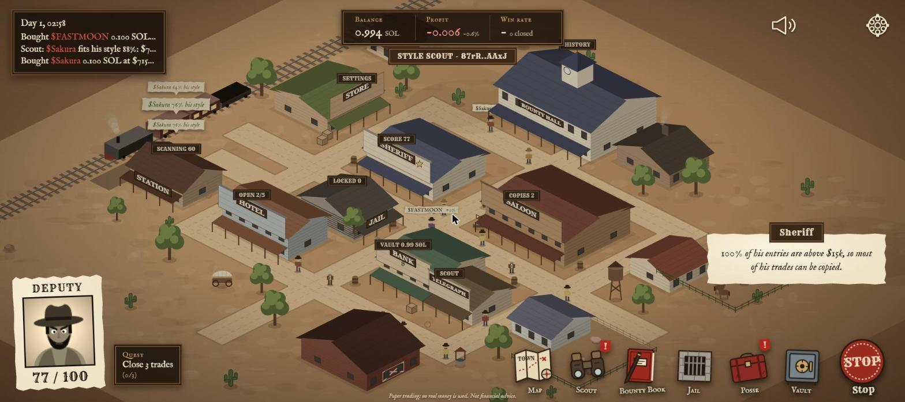
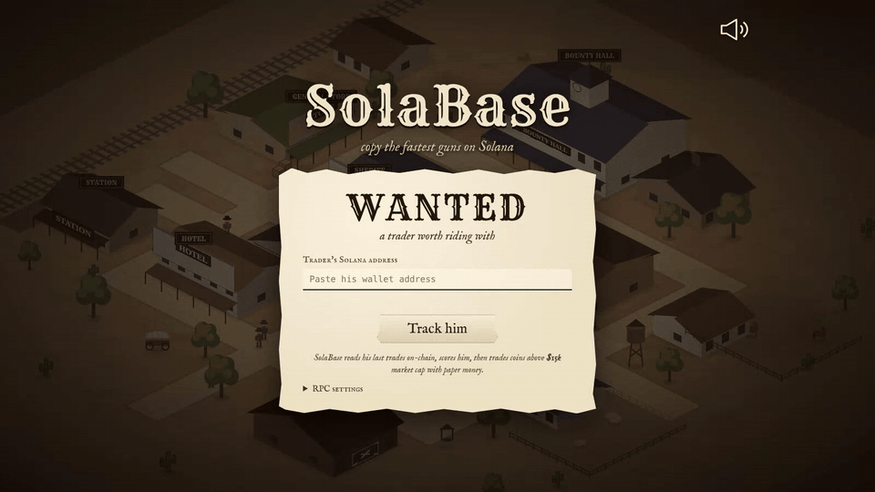
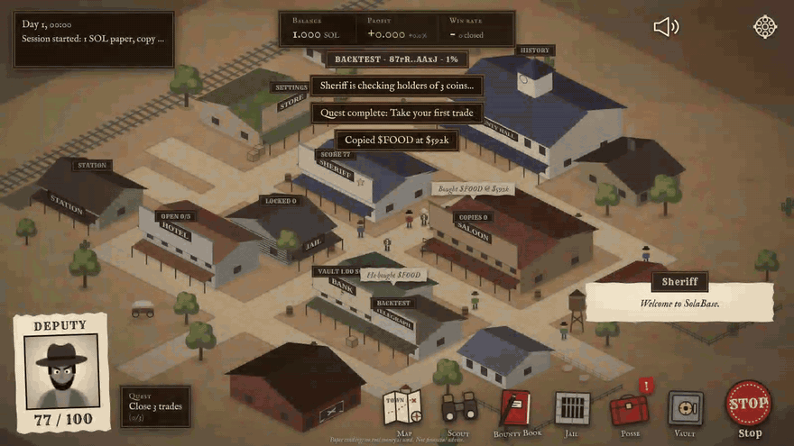
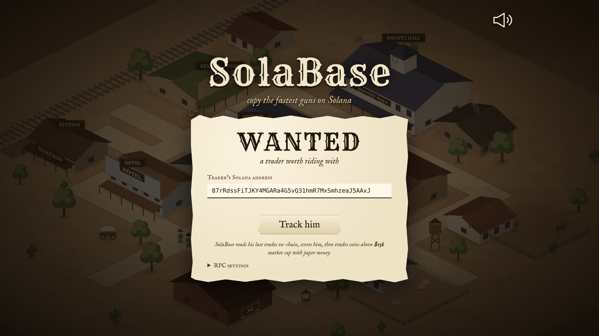
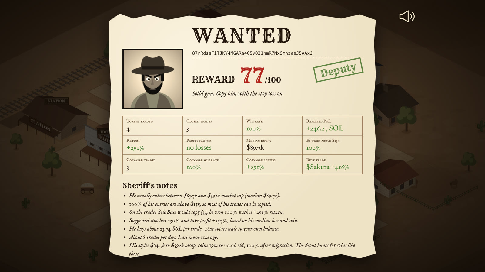
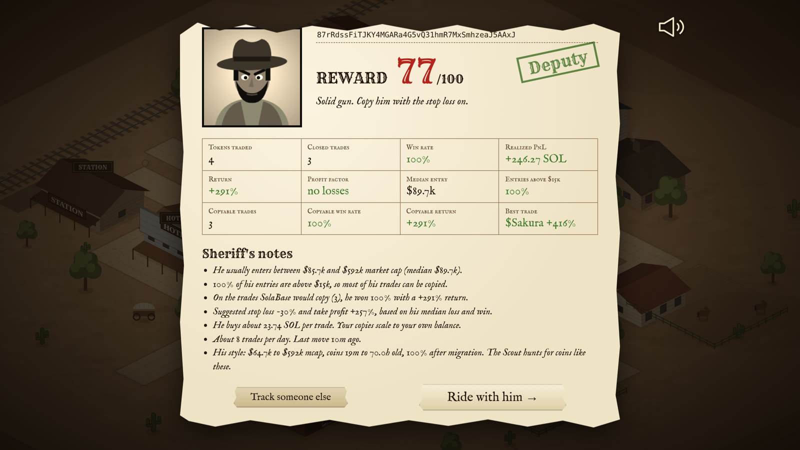
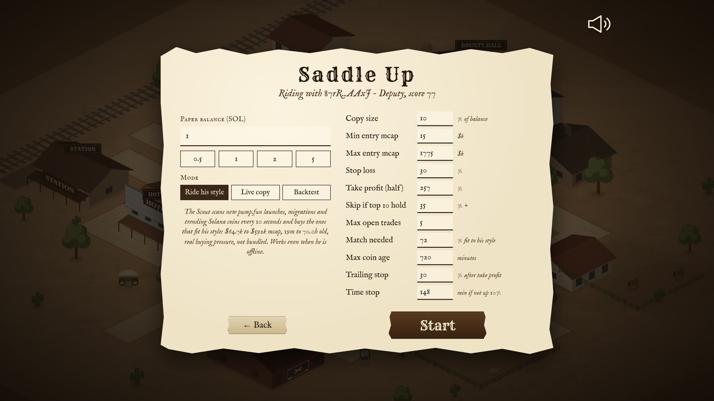
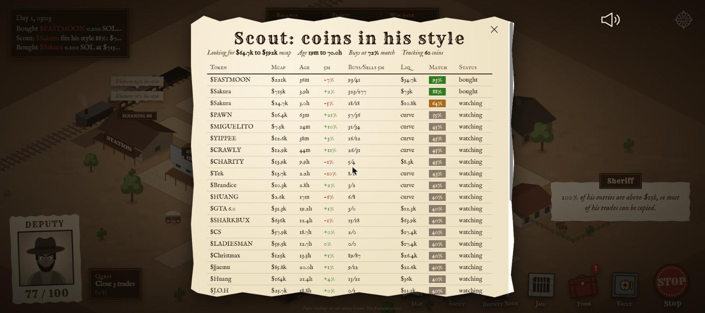
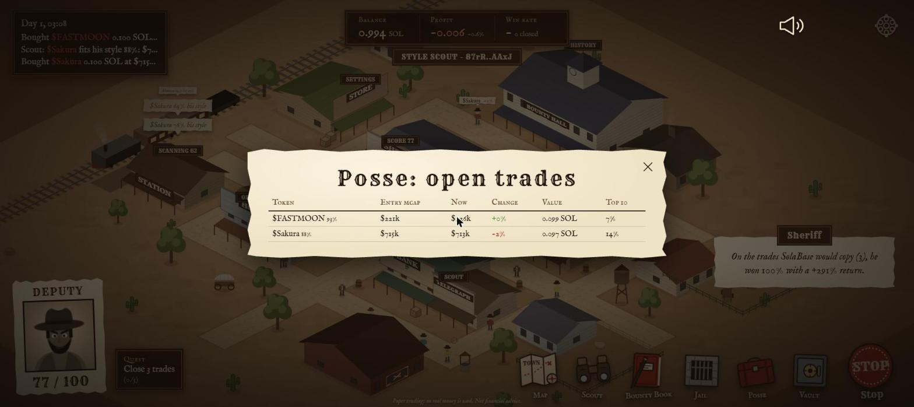
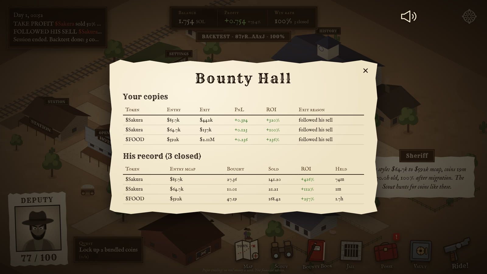

# SolaBase

A wild west paper-trading terminal for Solana. Paste a trader's wallet. SolaBase reads his on-chain history, scores him, learns his style, and then trades coins that match that style with paper money. The whole session plays out in a western town where every building is a live stat.

> **Paper trading only.** SolaBase never connects a wallet and never sends a transaction. Market data is real (Solana RPC, DexScreener, PumpPortal, RugCheck), but every trade and PnL figure is simulated in your browser. Not financial advice.



## See it in action

### Track a trader


### The town during a backtest


## Run it

No install, no build, no server.

1. Download or clone the repo.
2. Open `index.html` in Chrome, Edge or Firefox.

Or host it for free with GitHub Pages: **Settings → Pages → Deploy from branch → main / root**.

## How to use

1. Paste a trader's Solana address and press **Track him** (or Enter).
2. Read the Wanted poster: score out of 100, rank, and the Sheriff's notes.
3. Press **Ride with him**, pick a paper balance and a mode, adjust the rules if you want, and press **Start**.

| Intro | Wanted poster |
|---|---|
|  |  |

| Sheriff's notes | Saddle Up |
|---|---|
|  |  |

## The Wanted poster

SolaBase scans the wallet's recent transactions (400 by default, up to 1500, or swaps only with a Helius key), pulls out every swap and rebuilds each trade:

- what he bought and how much SOL he put in
- the market cap at his entry
- how old the coin was when he bought it
- before or after pump.fun migration
- how long he held, and what he made or lost

From that it prints a score out of 100 and a rank: **Sheriff, Deputy, Drifter or Outlaw**, plus plain-English notes and a suggested stop loss and take profit based on his own numbers. Wallets that mostly snipe below $15k get flagged.

## Modes

| Mode | What it does |
|---|---|
| **Ride his style** | The Scout finds new coins that match his market cap band, coin age and venue, and buys the ones with a high enough match score. Works while he is offline. |
| **Live copy** | Watches his wallet on-chain every few seconds, copies his buys that pass your filters, and sells the same share when he sells. |
| **Backtest** | Replays his last closed trades with his real entries and exits. |



## The Sheriff's rules

Every trade, in every mode:

- **Minimum $15k market cap** at entry.
- **The Jail:** holders checked on RugCheck. Top 10 holding too much, insiders in the top 10, or a danger flag means no buy.
- **Botted volume** (hundreds of trades in 5 minutes, almost all buys) is skipped.
- **Fixed size:** a % of balance per trade, minimum **0.01 SOL**, capped number of open trades.
- **Exits:** stop loss, half taken at target, trailing stop on the rest, time stop if the coin goes nowhere.
- Every fill pays **1% fees and 2% slippage**.

All of these can be changed on the Saddle Up screen.



## The town

| Building | Shows |
|---|---|
| Station | The Scout's scan. A train pulls in when a coin migrates. |
| Saloon | Every buy. |
| Bank | Winning trades carry their bag into the vault. |
| Sheriff's office | Stop losses. A robber runs off with the bag. |
| Jail | Coins locked up for bundles or bad holders. |
| Telegraph | The trader's own buys and sells, live. |
| Hotel | Your open trades. |

Each open trade is a cowboy in the street with his ticker and live PnL above his hat. The side panels (Scout, Bounty Book, Jail, Posse, Vault) show the full lists.



## Settings

Open **RPC settings** on the first screen.

- **Helius API key** (free at helius.dev): recommended. Reads only swaps and scans busy wallets about 10x faster.
- **Solana RPC URL**: used when there is no Helius key. Default `https://solana-rpc.publicnode.com`.
- **Transactions to scan without Helius**: 200, 400, 800 or 1500.

Settings, the last address and your balance are saved in your browser's local storage. Music has a mute button and a volume slider. Esc closes a side panel.

## Data sources

| Source | Used for |
|---|---|
| Solana RPC / Helius | The trader's transactions and swaps |
| DexScreener | Prices, market caps, trending, boosted and community takeover coins |
| PumpPortal (free feed) | New pump.fun launches and migrations |
| RugCheck | Top holders, insiders, risk flags |
| CoinGecko | SOL price |

Prices update about every 10 seconds, so a fast coin can fill worse than its stop, like a real trade.

## Project layout

```
index.html        the app, one self-contained file (CSS, JS and music inlined)
build.py          rebuilds index.html from src/
src/shell.html    page markup
src/style.css     styles
src/data.js       RPC, wallet analysis, scoring, paper engine
src/town.js       the painted town and its people
src/finder.js     the Scout (style matching)
src/ui.js         screens, panels, settings, music
src/music.mp3     background music
```

Edit anything in `src/`, then run `python3 build.py` to regenerate `index.html`.

## License

MIT, see [LICENSE](LICENSE). Not affiliated with Solana, pump.fun, DexScreener, PumpPortal, RugCheck, Helius or CoinGecko. Memecoins can go to zero.
